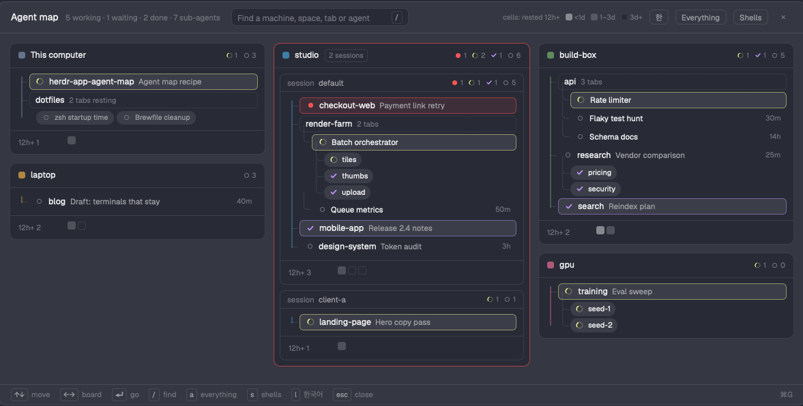

# Agent Map for Herdr

**See every agent you run, on every computer, at a glance, and jump to any of them.** One window in the [Herdr app](https://herdr.dev) (`⌘G`) with a board per computer and, inside it, a tree from hc session to space, tab, agent and the sub-agents it started. Only what has a shape branches; what has rested for half a day folds away.



## Why

With a few computers, a few hc sessions each and dozens of spaces, the sidebar shows one place at a time. ⌘P finds a thing you can name; this shows how everything hangs together: which machine, which space, which tab, which agent spawned which helpers, and what is waiting for you.

## Features

- **A board per computer.** Machine entries are grouped by host as [Machine Rail](https://github.com/jenthous/herdr-machine-rail) does, with its names, colors and order when it's installed. A computer with two or more hc sessions gets a block per session.
- **1:1 is one line.** A space whose one tab holds one agent is a single row: space, tab, status. A space with several tabs or terminals branches into them; an agent with sub-agents (terminals it started, `parent` in hc) branches into pills.
- **Agent icons.** Each agent row starts with its agent's icon from Herdr and ends with its status mark, like the sidebar's agent list. Icons keep their colors while the agent is active or has rested under 6 hours, then turn a darker gray the longer it rests.
- **Herdr's marks.** Working spins, waiting is a red dot, done is a check, idle an empty ring. Working and done color their first words; only a waiting agent gets a red box, and a board with one gets a red edge.
- **You are here.** The terminal you were in when you opened the map has a box and a slowly blinking eye, and never folds away; the arrows start from it.
- **How long.** A working agent or sub-agent shows how long it has been at it, a waiting one how long it has waited (red).
- **Background.** Terminals running with no tab and no parent in one (`hc run --bg --no-parent`, a script started outside Herdr) get a group of their own in their session, with how long they've run; a click peeks at one.
- **Rest folds away.** Idle rows show how long they've rested. After 12 hours an agent alone in its space becomes a small cell under the tree (lighter under a day, darker after three); in a space where everything rests, its tabs get dimmer the longer they've rested (newest first). Pills are only for sub-agents. **Everything** (`a`) unfolds it all; **Shells** (`s`) adds terminals without an agent.
- **Go there.** A click, or ↑↓ / ←→ and Enter, shows that agent (`agent.focus`) or shell and closes the window. Terminal ids appear on hover.
- **Preview on hover.** Point at any row, pill or cell: a card beside it shows its last screen lines at once (under the selection when you use the arrows).
- **Boards stay put.** A computer keeps its column; drag a board's head to move it, `=` to lay them all out again.
- **Find.** `/` filters by computer, session, space, tab, agent or sub-agent name.
- **English and Korean.** `EN`/`한` or `l`.
- **Update check.** "Update Agent Map" in the header when a newer release is out (at most one GitHub request a day; "Stop checking" turns it off).

## Install

Ask the agent in your Herdr terminal: *"add herdr.dev/mods/jenthous/herdr-app-agent-map"*.

Or by hand: copy `mods/agent-map` into `~/.config/herdr-app/mods/`, merge `keys.json` into `~/.config/herdr-app/keys.json`, then `herdr-app check ~/.config/herdr-app/mods/agent-map`.

## Keys

| Key | Does |
|---|---|
| `⌘G` | open / close the map |
| `↑` `↓` | previous / next row, pill or cell |
| `←` `→` | previous / next board |
| `⏎` | go there |
| `/` | find |
| `a` | everything (no folding) |
| `s` | shells too |
| `l` | English / Korean |
| `=` | lay the boards out again |
| `esc` | clear the search, else close |

## What it touches

- **Programs:** `hc machine ls --json` when the window opens, and `hc get <terminal> --json` for each agent whose status changed (when it last changed; up to 8 at a time, while the window is open), and `hc read <terminal> --json` for the one under the pointer (at most every 15 s each).
- **Files:** `mods/agent-map/config.json` and `mods/machine-switch/config.json` (language), read only.
- **Network:** at most once a day, one GET to `api.github.com/repos/jenthous/herdr-app-agent-map/releases/latest` (no token, nothing about you).
- **Shared state:** `agent-map.layout`, `agent-map.all`, `agent-map.shells`, `agent-map.lang`, `agent-map.update`, `agent-map.icons` (`all`, `other`: only agents other than the usual one, `off`; default `all`); reads `machine.prefs`.

## Config

`mods/agent-map/config.json` (optional):

```json
{ "language": "en" }
```

`"demo": true` shows made-up computers instead of yours (for screenshots).

## License

MIT
