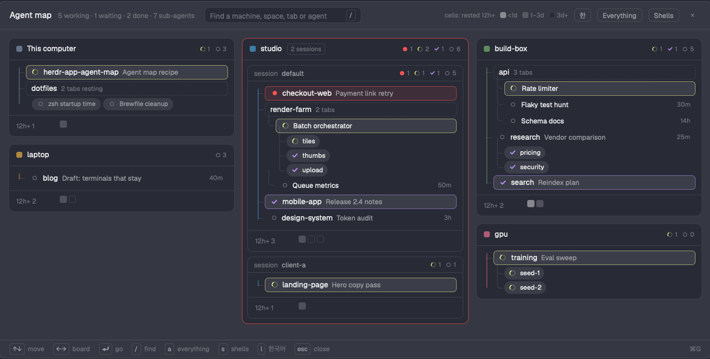

# Agent Map

A window (`⌘G`) with a board per computer Herdr reaches and, inside each, a tree from hc session to space, tab, agent and the sub-agents it started. A space whose one tab holds one agent is one line; the tree branches only where something is several (tabs, terminals, sub-agents). Agents that have rested for 12 hours fold into small cells; spaces where everything rests fold into one line of tab pills. Arrow keys or a click go to any of them.

## What you see

- **Window:** a `window` overlay, key `agent-map`, 1180 px wide, 85% of the window high, `popover` background, 12.5 px text.
- **Header (46 px, 16 px sides, 1 px `border` below):** "Agent map" 14 px semibold; a `dim` 11.5 px summary "5 working · 1 waiting · 2 done · 7 sub-agents"; a 260×26 px search field (radius 7, `background`, `border`, `accent` border while it has text) with the hint "Find a machine, space, tab or agent" drawn beside the input and a `/` key cap; then on the right: the legend "cells: rested 12h+" with three 10 px swatches (<1d, 1–3d, 3d+; hidden while Everything is on or while searching), the update pill when a release waits, three 22 px chips: `한` (`EN` in Korean), "Everything", "Shells" (on: `raised` with `foreground` text and a `muted` border), and ×.
- **Body (scrolls):** 14 px padding, three equal columns 12 px apart. A computer keeps the column and place it was given (shared `agent-map.layout`: `{ cols: [[host…], [host…], [host…]] }`); one seen for the first time goes under the column that is shortest at that moment (by row count). Drag a board by its head to move it: it fades to 40% and a 3 px `accent` bar shows where it lands (above the board under the pointer, or at the end of a column: a 120 px drop zone appears under each column while dragging). `=` forgets the layout and places them all afresh.
- **Board:** radius 10, `background`, 1 px `border` (`blocked` at 60% when an agent there is waiting).
  - Head 36 px: a 10 px square in the computer's color (radius 3), its name semibold, "2 sessions" in a small bordered tag when it has several, and on the right the counts: a 12 px mark and a number for waiting, working and done when non-zero, and idle always (`dim` 10.5 px).
  - Several sessions: one block each (8 px in, radius 8, `border`), a 26 px head "session default" (name semibold `muted`) with the same counts, then that session's tree and cells.
- **Tree:** 16 px in from the left. Lines are in the computer's color and belong to the item they lead to, so a line stops at the last item and turns into it with a rounded corner (├ … └), never running past it; they're drawn over the rows.
  - The spine (session → spaces): 2 px at 67%, 12 px left of the rows; it meets a row 4 px short of its status mark (a dashed box at its edge); the last corner has radius 6.
  - Branches (space → tabs, agent → sub-agents): 1 px at 40%, rows 28 px in; under a status mark the line drops from 15 px in (just below the mark), under a dashed box from its bottom 10 px in; the last corner has radius 5.
  - Rows 24 px high, radius 6, 8 px sides, 3 px apart.
  - **1:1 space:** one row: status mark, the space name (medium, up to 200 px), the tab name in `muted` 11.5 px (left out when it equals the space name), then on the right how long it has rested (`dim` 10.5 px: "40m", "14h", "3d"; only for agents not working, waiting or done). A working agent shows instead how long it has been working, in `working` ("<1m", "36m", "1h 12m", "2d 3h"); a waiting one how long it has waited, in `blocked`. Both come from `status_ms` in `hc get` (when its status last changed) and are shown beside the eye when it is the one you are in.
  - **Several tabs or terminals:** a dashed-bordered row with the space name and "3 tabs" (or "2 terminals"), then a branch per terminal: a row named by its tab.
  - **Sub-agents** (the only pills): under their agent's row, a branch each: 22 px, radius 11, `raised`, 11 px, the status mark and the sub-agent's name; "· tab" when it also has a pane of its own.
  - **Everything rests (no agent working, waiting or done, none you're in, no sub-agents) and several tabs:** the dashed row says "machine-web 2 tabs resting"; its tabs branch as rows, newest rest first, the text dimmer in four steps: under 12 h `foreground`, under a day `muted`, 1–3 days `dim`, older (or unknown) `dim` at 60%; each with its rest time on the right.
  - **Boxes:** only a waiting row (1 px `blocked` at 53% on a 10% `blocked` tint) and the row of the terminal you were in (1 px `accent` at 67%) get one; other rows keep an invisible 1 px border in the board's color. Working says so by its spinner and its first words in `working`, done by its check and `done`; resting rows by brightness.
  - **You are here:** the terminal focused when the map opened: its box, and a 13 px `icons/eye.svg` in `accent` at the right end that fades between 100% and 20% every 1.6 s (no words, no rest time). It never folds.
  - Shells (with Shells on) get a dashed "shell" tag.
  - The terminal id (`studio/t3x`) shows only in the hover card.
- **Preview card:** 376 px wide, `raised`, `border`, radius 8, large shadow, 10 px padding: the space · tab (or name, with the rest time for a cell) semibold 11.5 px and the address in mono `dim` on the right, then the last 6 non-empty lines of its screen in mono 11.5 px `muted`, each cut to one line ("Reading…" until read).
  - **For the pointer**, at once (no tooltip delay), drawn by the window at a place worked out from the item's and the window's bounds (`on_mouse_move`), and not drawn until both are known, so it never appears elsewhere first: beside a row or pill, its top level with it, over the neighbouring column (to the right; to the left from the right-hand column), so the column you move down stays clear; under a cell, 4 px below (you move across cells). Kept 8 px inside the window, below the header and above the footer.
  - **For the arrow keys:** under the selected item, by a `Popup` anchored `top_left`, 4 px below.
  - A card can't let the pointer through: when the pointer reaches it, it closes (until that item is left and pointed at again, or the arrows move). Pointing at any item ends the keyboard card; leaving the window closes the pointer's.
- **Cells:** under the tree (1 px `border` above when there is a tree), 12 px left: "12h+ 3" (and "shells 2") in `dim` 11 px, 64 px wide, then 12 px squares (radius 3), 3 px apart, wrapping, newest first: `muted` 80% under a day, `muted` 33% from one to three days, `background` with a `border` after; shells as dashed squares after a 6 px gap. Tooltip: "space › tab · address · 2d".
- **Footer (30 px, 1 px `border` above, `dim` 11 px):** key caps and words: ↑↓ move, ←→ board, ⏎ go, / find, a everything, s shells, l 한국어, = re-place, esc close; ⌘G on the right.
- **Status marks (14 px slot, 12 px in counts):** working: `icons/spinner.svg` 11 px in `working`, spinning (900 ms); waiting (blocked or error): a 7 px `blocked` dot; done: `icons/check.svg` 12 px in `done`; idle: a 7 px ring, 1.5 px `idle` (else `dim`); shell: a 7 px square, radius 2, `border`.

## How it behaves

- **Statuses:** working, blocked, done and idle come from the pane (`panes()`), live. Done is "finished while you weren't looking"; after you look it's idle. Sub-agents take the plain status word from `terminals()`.
- **What folds (off while Everything is on or while searching):** an agent alone in its space (one tab, one terminal), idle, without sub-agents, not the one you were in, whose status last changed 12 hours ago or more (or unknown), becomes a cell; a shell alone in its space too. A space with several tabs or terminals where none is working, waiting or done, none is yours and none has sub-agents keeps its rows but shows them as resting (above). Everything else stays in the tree as is.
- **Rest time:** `status_ms` from `hc get <address> --json`, read for every pane terminal with a status when the window opens and again for those whose status changed (every 30 s while open, up to 8 at a time); kept in memory across opens.
- **Going there:** a click on a row, pill or cell, or Enter on the selected one: an agent → `agent.focus {terminal}` (sub-agents too); a shell → `space.select {id}`, `tab.select {id}`, `pane.focus {pane}`. Then the window closes.
- **Keys** (on the window; while typing in the search only Esc, ↑↓ and Enter): ↑↓ select the previous / next row, pill or cell in reading order (column by column, top to bottom), wrapping; ←→ the first one of the previous / next board; Enter go; `/` focus the search; `a` Everything; `s` Shells; `l` English / Korean; `=` place the boards afresh; Esc clears the search, else leaves the search, else closes. The selected item gets an `accent` border once an arrow key has been pressed (the selection starts on the terminal you were in, unmarked). Enter in the search goes to the selected or first match.
- **Search:** case-insensitive substring over the computer's name, the session, the space, the tab, the agent's app and name, its address and its sub-agents' names; only matching terminals are shown, unfolded.
- **Saved:** the board layout (`agent-map.layout`), Everything and Shells (shared `agent-map.all`, `agent-map.shells`) and the language picked here (`agent-map.lang`).
- **Language:** the one picked here, else `language` in `mods/agent-map/config.json`, else in `mods/machine-switch/config.json`, else macOS `AppleLanguages`, else English.
- **Screen preview:** `hc read <address> --json` on hover, at most every 15 s per terminal, kept in memory; lines under a `────` rule in the last 14 (an agent's input box and status) are dropped, blank ones too, long indents shortened, lines cut at 110 characters.
- **Update check:** on open, at most once a day, one GET to `api.github.com/repos/jenthous/herdr-app-agent-map/releases/latest` (no token), remembered in shared `agent-map.update`. A tag newer than `0.1.3` shows "Update Agent Map" (a 6 px `accent` dot, 11.5 px `accent`) in the header; it opens a 460×400 dialog (this mod, props `{ role: "update", lang }`) with the release notes, the prompt for the agent, "Stop checking", Later, Release page, Copy prompt. `update.js` is the same file as in herdr-machine-rail and herdr-app-linear.
- **Demo:** `"demo": true` in `config.json` shows the made-up computers of `demo.js` (nothing is run, clicks go nowhere, Everything and Shells start off).

## Built from

- **Mod:** `mods/agent-map` (`mod.json`: `place: none`, the overlay above): `main.js` (the window), `update.js` (release check and dialog), `demo.js`, `icons/spinner.svg`, `icons/check.svg`, `icons/eye.svg`. `keys.json`: `cmd-g` → `mod.open:agent-map`.
- **Computers:** `hc machine ls --json`, `temporary` ones skipped, grouped by `host` (else target, else name); within a computer the entry without `session` first. Names, colors (nine named colors) and order from shared `machine.prefs` (`alias["g:<host>"]`, `color`, `order`), as Machine Rail keeps them; this computer is `@local`.
- **herdr:** `focused()` (the terminal you were in), `spaces()` (tabs and `machine`), `panes()` (terminal, tab, status, app), `terminals()` (`parent`, `name`, `state`, `status`), `hc`, `exec` (`defaults read -g AppleLanguages`), `readTextFile`, `shared`/`setShared`, `run` (`agent.focus`, `space.select`, `tab.select`, `pane.focus`), `openOverlay`/`closeOverlay`, `props`, `theme`.
- **gpui:** `h_flex`/`v_flex`, `InputState`/`Input`, `svg(...).spin()`, `loop("opacity")`, `on_hover`/`on_mouse_move` (bounds), `tooltip`, `overflow_y_scrollbar`, `border_dashed`.

## Watch out

- `panes()` has no time; `tab.changed_at` only counts since the app started. The rest time needs `hc get` per terminal: cache it and ask only when the status changed.
- A sub-agent with its own pane is in `panes()` too: it shows as its own row where its tab is and as a pill ("· tab") under its parent.
- Theme colors may carry alpha (`#rrggbbaa`): cut to `#rrggbb` before adding an opacity.
- A pill inside a column stretches to its width: put each in its own row (`h_flex`).
- The input's placeholder is fixed when it's created, before the language is known: draw the hint yourself.
- Selection doesn't scroll the body yet: an item below the fold can be selected out of sight.
- `mod.open` toggles: opening it again while it's open closes it.

## Done when

- `herdr-app check mods/agent-map` passes and `⌘G` opens the window; again closes it.
- A computer with two hc sessions shows one board with two session blocks.
- A space with one tab and one agent is one row; a space with two tabs branches into two rows; an agent that started helpers (`parent`) shows them as pills under it.
- An idle agent alone in its space shows its rest time; once it has rested 12 h it moves into the cells; `a` brings it back to the tree.
- Clicking a row, pill or cell shows that agent and closes the window; ↑↓ and Enter do the same; `/` and typing a tab's name leaves only that branch.
- `l` switches English / Korean and stays after reopening.
- A board stays in its column when agents start and stop; dragging its head to another column moves it there for good; `=` re-places them.
- Pointing down a column, each row's card shows beside it at once, never under the pointer.
- With a release newer than `0.1.3` on GitHub, the header shows "Update Agent Map".
